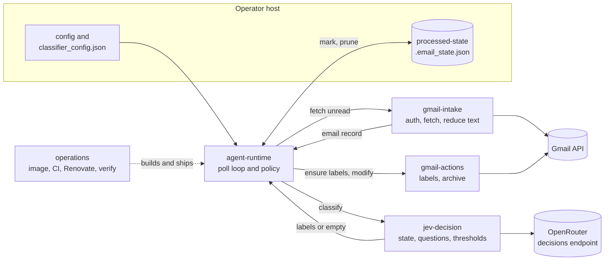

# High-Level Design: Gmail Email Classifier

## Problem

A personal Gmail inbox accumulates mail faster than one person files it. Gmail's own filters key on sender and keywords, which breaks on newsletters, receipts, and notifications that arrive from many addresses with varied wording. Hand-labeling is tedious and stops happening. The result is an inbox where the operator cannot tell at a glance what needs attention.

The operator wants mail sorted into their own labels, by meaning, continuously, at negligible cost, on a home-lab host, with nothing sent to a model that does not need to be sent.

## Approach

A single long-running agent polls the Gmail inbox for unread messages, asks a decision model which of the operator's configured labels fit each one, applies those labels in Gmail, and remembers what it has handled.

### Decide, do not generate

Classification uses Jev, TypeSafe's non-generative decision model, through OpenRouter's decisions endpoint. The agent sends the email as a structured object and one typed question per label plus a best-label choice; Jev returns probabilities. It emits no text and cannot name a label outside the configured set, so there is no prompt to defend, no output to parse, and no injection guard. Thresholds in code turn probabilities into labels.

### Reduce before sending

Before any email text leaves the process, URLs are cut to scheme and host, HTML is reduced to visible text, and the body is capped. This removes tracking tokens that often identify the recipient and removes markup that hurts classification accuracy.

### Remember independently of Gmail

A local ledger of processed message ids, with retention, decides whether a message is classified. Gmail's read state is left alone so the operator still sees new mail as new.

### Ship on merge

Every push to `main` produces a scanned, signed, multi-architecture container image. Renovate keeps dependencies current with human review reserved for major versions.

## Target Users

One operator running one agent against one Gmail account on a home-lab host, typically as a Docker container with a mounted data volume. They edit a JSON file to define labels and descriptions, tune two thresholds from debug logs, and otherwise expect the agent to run unattended for months.

## Goals

- Every unread inbox message is classified within one poll interval of arriving and is sent to the model at most once per retention window.
- Labels applied in Gmail are always drawn from the operator's configured set; nothing else is ever applied.
- An email the model cannot place is still visible to the operator (left in the inbox, optionally under a review label) rather than silently filed.
- Cost stays near the model's list price per email (on the order of $0.0001) with no other paid services.
- The operator can change labels, descriptions, and thresholds and preview the effect on real mail with zero side effects (dry run).

## Non-Goals

- **Not a spam or phishing filter.** Gmail's own protections run first; this agent only labels what reaches the inbox.
- **Never sends, replies, forwards, deletes, or marks read.** The only mutations are adding labels and removing a message from the inbox.
- **One account, one instance.** No multi-account support and no horizontal scaling; two instances would race on the same mail and ledger.
- **Flat labels only.** Nested Gmail labels (`Parent/Child`) are not supported.
- **No feedback loop.** The agent does not learn from the operator moving or relabeling mail; tuning is manual via descriptions and thresholds.
- **No user interface.** Logs are the only output.
- **Does not revisit mail already read or archived.** Only unread inbox messages are candidates.

## Tenets

Ordered so that an earlier tenet wins a conflict with a later one.

1. **Keep polling over stopping.** When one email or one poll fails, log it and continue; the loop ends only on an operator interrupt. The opposite, stopping on the first unexpected failure so nothing is silently skipped, is a reasonable choice this project does not make.
2. **Send less to the model.** When unsure whether a piece of email content helps classification, strip it before sending. The opposite, sending the full message and letting the model weigh it, trades privacy and accuracy on noisy mail for simplicity.
3. **Classify once over classify eventually.** When the outcome of handling an email is uncertain (model unreachable, label write failed), prefer marking it handled and moving on over retrying until success. The opposite, retrying so no email is ever skipped, is the choice the code made before the Jev rewrite and remains available if skipped mail during outages becomes a real cost.
4. **Current by default.** Dependency and base-image updates land automatically after a short stability window; humans review majors only. The opposite, reviewing every update, is defensible for a service with more users than this one.

## System Design

Six segments, named for the stage of an email's path they own. Five form the mail path; the sixth delivers the agent.

One poll cycle, as agent-runtime sequences it:

1. Prune the ledger by retention.
2. gmail-intake lists up to `MAX_EMAILS_PER_POLL` messages labeled `INBOX` and `UNREAD`, fetches each in full, and reduces the body.
3. For each record not in the ledger, jev-decision builds the state and questions, posts once with one retry, and applies the threshold rule.
4. Labels found: gmail-actions adds them and removes the message from the inbox in one call (archiving is configurable). None found: the message stays in the inbox, optionally under a review label.
5. The id is written to the ledger. The loop sleeps one interval.

Segment ownership of the two shared files: `gmail_client.py` is split between gmail-intake (read side and authentication) and gmail-actions (write side); `email_classifier_agent.py` is split between agent-runtime (construction, policy, loop) and processed-state (ledger methods). `llm_utils.py` belongs to gmail-intake except `log_classification_result`, which jev-decision specifies.

Segment design docs live under `docs/intent/<segment>/`; status and findings per segment live under `docs/arrows/` with `index.yaml` as the manifest.

## Key Design Decisions

**A decision model instead of a chat model.** The first classifier was a chat LLM behind a prompt-injection guard and a LiteLLM gateway. The guard produced confident false positives on ordinary marketing mail and the gateway added latency and operational surface. Jev's output space is the label set, so the worst an adversarial email can do is nudge a probability. The guard, the gateway, prompt fencing, JSON parsing, and the rejection-retry path were all removed rather than tuned. The alternative, a better guard in front of a chat model, was rejected because its failure mode was the thing being fixed. Detail: `docs/intent/jev-decision/`.

**Direct to OpenRouter, no gateway.** The decisions endpoint is called directly with the OpenRouter key. A gateway bought nothing once there was no guardrail to run and cost a hop on an endpoint already marked alpha.

**One Noul per label plus a Choice with `None`.** Independent yes/no questions give true multi-label results and avoid option-order bias; the Choice rescues emails that fit one label weakly. The alternative, a Choice alone with thresholded probabilities, fails on genuinely two-label mail because its probabilities sum to one.

**A local ledger rather than Gmail read state.** Marking mail read would hide it from the operator; labeling alone cannot express "already considered". A JSON file of ids with timestamps is inspectable, mounts as a volume, and expires entries so it cannot grow forever. Detail: `docs/intent/processed-state/`.

**Reduce text at both ends.** The Gmail client reduces before its length cap so link-heavy mail keeps its words; the classifier reduces again so it is correct for any caller. The duplication is accepted; the 5000-character cap predates Jev and is under review. Detail: `docs/intent/gmail-intake/`, `docs/intent/jev-decision/`.

**Mark processed on every outcome.** Labeled, sent to review, no label, or a swallowed failure all end with the id in the ledger; only an unexpected exception leaves an email for the next poll. This is the simplest rule that guarantees no double classification. Its cost, that a transient outage skips mail for the retention window, is accepted under the tenet *classify once over classify eventually*. Detail: `docs/intent/agent-runtime/`.

**Distroless image, merge means ship.** Chainguard Python images pinned by digest, dependencies from the frozen lockfile, `nonroot` runtime, no secrets in the image. A push to `main` runs dependency scans, builds for amd64, signs with cosign, and attests SBOM and provenance. Detail: `docs/intent/operations/`.

## Success Metrics

- **Labeling rate.** The share of processed mail that receives at least one configured label. A falling rate with unchanged mail is a signal to revisit descriptions or thresholds.
- **Review-label rate.** The share landing under the review label (when configured). It should be small and stable; a spike means descriptions no longer match the mail.
- **Operator corrections.** How often the operator moves or relabels mail the agent filed. There is no automated measure; the operator's own sense of "I stopped fixing it" is the signal.
- **Cost.** Monthly OpenRouter spend near the per-email list price times mail volume, visible in the OpenRouter activity dashboard.
- **Liveness.** The agent has not silently hung. Today the only signal is log activity; a health check is an open item in operations.

Falsification: the project is judged broken if mail is routinely classified twice, if a label outside the configured set ever appears, or if an outage of the model endpoint goes unnoticed for more than a day.

## FAQ

**Why are labeled emails still unread?** By design. The ledger, not read state, prevents reprocessing, and the operator should see new mail as new.

**Why did a newsletter get two labels?** Two descriptions overlap enough that both Nouls cleared the threshold. Make the descriptions mutually distinguishable or raise `JEV_LABEL_THRESHOLD`.

**The model was down for an hour. Will those emails be classified later?** Not within the retention window. They were marked processed with no label and left in the inbox (under the review label if set), per the tenet *classify once over classify eventually*.

## References

- Segment design docs: `docs/intent/gmail-intake/`, `docs/intent/jev-decision/`, `docs/intent/gmail-actions/`, `docs/intent/processed-state/`, `docs/intent/agent-runtime/`, `docs/intent/operations/`
- Arrow overlay: `docs/arrows/index.yaml` and one status doc per segment
- Operator docs: README.md, DEPLOYMENT.md, TESTING.md
- Jev: https://openrouter.ai/blog/insights/what-is-jev/ ; OpenRouter decisions endpoint: https://openrouter.ai/api/alpha/decisions
- Original migration reasoning: `git show d4b1ed1:docs/jev-migration-plan.md`
